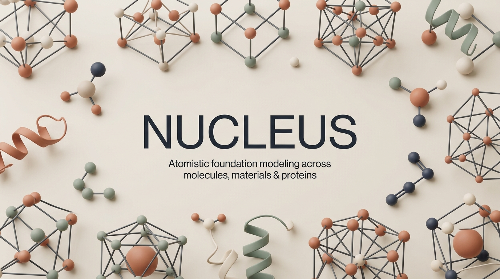

<p align="center">
  
</p>

# Nucleus

Nucleus is the shared monorepo for **Zatom-2**, an atomistic foundation model for
molecules, materials, and protein generation, and **Zevals**, its evaluation
pipelines. It includes training code, paper configurations, data preparation
tools, the inference CLI, and Zatom-2's project page.

[Project page](https://zatom-ai.github.io/nucleus) ·
[arXiv](https://arxiv.org/abs/2610.11454) ·
[Weights](https://huggingface.co/Zatom-AI/Zatom-2) ·
[PyPI](https://pypi.org/project/zatom-nucleus/)

## Install

### From PyPI

`zatom-nucleus` and `zatom2` can be installed using [uv](https://docs.astral.sh/uv/) (recommended) or `pip`:

```bash
uv venv
source .venv/bin/activate
uv pip install zatom-nucleus zatom2
```

*(or `uv pip install "zatom-nucleus[all]"` to include `zevals`)*

> [!TIP]
> When managing environments with `uv venv`, install packages with `uv pip install` rather than bare `pip install`. Because `uv venv` does not install `pip` inside the virtual environment by default, running `pip` directly can invoke an outer Python or Conda environment on your `PATH` and cause dynamic library conflicts (such as duplicate OpenMP runtime initializations on macOS). Alternatively, create your virtual environment with `uv venv --seed` if you require standard `pip`.

### From source

Use Python 3.12 and [uv](https://docs.astral.sh/uv/). The paper environment uses
Linux, NVIDIA A100 80 GB GPUs, PyTorch 2.13, and CUDA 13.2. A compatible NVIDIA
driver is required for GPU execution. The lockfile pins public AtomWorks and
Foundry revisions.

```bash
git clone https://github.com/Zatom-AI/nucleus.git
cd nucleus
uv sync --locked --extra all
source .venv/bin/activate
```

One root installation provides `nucleus`, `zatom2`, and `zevals`; separate
model-package installs are unnecessary. For training, copy `.env.example` to
`.env` and follow the [data preparation guide](docs/data.md). Inference on the
included molecule example does not require training datasets.

## Download weights and generate a molecule

```bash
nucleus list-available
nucleus install zatom2
zatom2 design inputs=models/zatom2/docs/examples/demo.json out_dir=logs/demo
```

`zatom2` selects the checksummed large joint-property model (configuration VI).
The downloader verifies SHA-256 and stores weights in `~/.nucleus/checkpoints`.
Use a paper identifier from `nucleus list-available` to select another model:

```bash
nucleus install zatom2-table3-scope-from-joint-properties-force-conditioned
zatom2 design \
  ckpt_path=zatom2-table3-scope-from-joint-properties-force-conditioned \
  inputs=models/zatom2/docs/examples/protein.json out_dir=logs/protein
```

See [inference](docs/inference.md) for force conditioning, custom checkpoint
directories, output formats, and evaluation. Weight availability is tracked in
the [release status](docs/release_status.md).

## Reproduce the paper

- [Paper-to-command guide](docs/reproducibility.md): pretraining, ablations,
  scaling, generation, structure/property prediction, and protein transfer.
- [Data preparation](docs/data.md): sources, licenses, frozen splits, LMDB
  loading, molecular bonds, and evaluation references.
- [Zevals](models/zevals/README.md): metrics and separate external-oracle setup.
- [Preprint source](models/zatom2/docs/manuscript/arxiv_preprint.tex) and
  [project page source](models/zatom2/docs/index.html).

## Repository layout

| Path | Contents |
| --- | --- |
| `src/nucleus/` | Shared architecture, trainers, transforms, metrics, and loaders |
| `src/nucleus_cli/` | Weight discovery and verified downloads |
| `models/zatom2/` | Zatom-2, Hydra configurations, examples, paper, and page |
| `models/zevals/` | Zevals pipelines, metrics, and oracle adapters |
| `scripts/` | Portable data preparation and paper analyses |
| `data/` | Small reproducibility artifacts and frozen selection indices |
| `tests/` | Regression tests for released functionality |

Code is distributed under the [Nucleus license](LICENSE.md). Dataset, model,
oracle, and webpage licenses are described in
[third-party notices](THIRD_PARTY_NOTICES.md). Citation metadata is in
[CITATION.cff](CITATION.cff).
