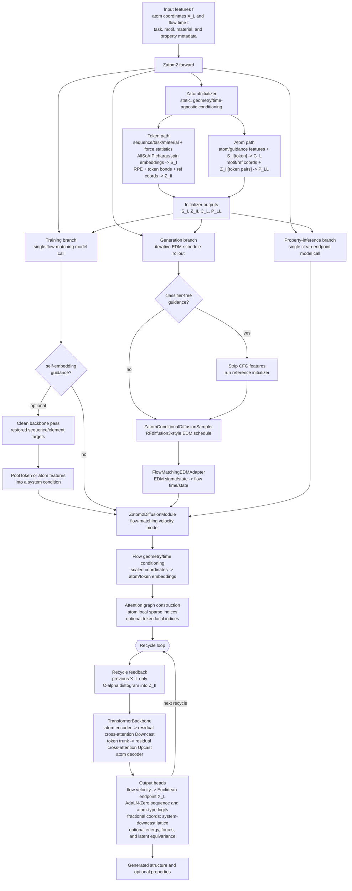

# Zatom-2

An atomistic foundation model for molecular, material, and protein generation.
Install the shared [Nucleus monorepo](../../README.md), then follow the
[inference CLI guide](../../docs/inference.md),
[paper reproduction guide](../../docs/reproducibility.md), and
[data preparation guide](../../docs/data.md).

The [project page](docs/index.html) and
[LaTeX source](docs/manuscript/arxiv_preprint.tex) are included.
[arXiv preprint](https://arxiv.org/abs/2610.11454).

## Model Architecture

The Zatom-2 model is wired by
[`Zatom2`](src/zatom2/model/Zatom2.py), with the simplified Hydra component
using [`ZatomInitializer`](../../src/nucleus/model/layers/encoders.py) and
[`Zatom2DiffusionModule`](src/zatom2/model/Zatom2_diffusion_module.py).
The current production configuration trains a flow-matching velocity model. At
generation time, `FlowMatchingEDMAdapter` converts the RFdiffusion3-style EDM
sampler state and noise schedule to flow state and time before each model call.

### Relationship to RFdiffusion3 and Emyx

Zatom-2 is closest to RFdiffusion3 at the wrapper and sampler level,
and closest to Emyx at the high-level atom-token-token-atom backbone layout. The
main architectural difference is that Zatom-2 generalizes the representation and
output heads for molecules and materials, while keeping a compact feature
initializer and a shared `TransformerBackbone`.

| Aspect | Zatom-2 | RFdiffusion3 | Emyx |
| --- | --- | --- | --- |
| Generative objective | Conditional flow-matching velocity model, reparameterized through `FlowMatchingEDMAdapter` for EDM-style sampling and optional classifier-free guidance. | EDM-preconditioned all-atom diffusion model with the same broad wrapper/sampler pattern. | Conditional flow matching model, with an exact reparameterization to EDM-style sampling. |
| Input representation | Variable atom/token mapping from AtomWorks features; supports molecular and material tokens/atoms. | Atom14/all-atom biomolecular representation; standard residues are tokenized as residue tokens and ligands/modified residues can be atom-tokenized. | Rep14 two-level protein representation: residues and HETATMs as tokens with fixed atom slots. |
| Initializer | `ZatomInitializer` embeds token 1D features, including force statistics and AllScAIP-style charge/spin conditioning, into `S_I`; token pair features into per-head `Z_II`; atom 1D features into `C_L`; and motif/ref/token-pair information into per-head `P_LL`. It follows the Emyx-style embedding role without using dynamic diffusion-step geometry or time. | `TokenInitializer` embeds token and atom features, builds token pair features with relative position, bonds, reference coordinates, and a small Pairformer stack, then builds atom-pair features `P_LL`. | Embedding initialization builds sparse connectivity, token/atom/time embeddings, and pair conditioning before the transformer trunk. |
| Main denoiser | `Zatom2DiffusionModule` injects scaled noisy coordinates and time into atom/token features, then runs one or more passes through a shared `TransformerBackbone`, with recycling limited to coordinate-derived distogram feedback. | RFD3 diffusion module first runs a local atom encoder, pools/downcasts to token features, runs a diffusion token encoder plus token transformer, then decodes back to atoms. | Atom encoder -> gated downcast -> deep sparse transformer trunk -> upcast -> atom decoder -> velocity head. |
| Atom/token bridge | `TransformerBackbone`: atom DiffusionTransformer -> `Downcast` -> token DiffusionTransformer -> `Upcast` -> atom DiffusionTransformer. | Learnable cross-attention replaces AF3-style mean pooling; decoder interleaves upcasts with atom transformer blocks. | Gated cross-attention bridges atom and token levels through the Rep14 mapping. |
| Pair features and attention | Dense token/atom pair-bias tensors from the initializer, with atom local sparse attention indices and optional token local attention. | Token and atom pair features from initializer plus diffusion token encoder; RFdiffusion3 emphasizes sequence-and-structure-local sparse atom attention. | Sparse edge graph with learned pair bias, avoiding quadratic dense Pairformer-style pair updates. |
| Recycling | Feeds back only the previous denoised coordinates as a C-alpha distogram added to `Z_II`; previous atom and token features are not recycled. | Recycles central-atom/C-alpha distogram through the diffusion token encoder; the paper notes that atom-level features are not recycled. | Recycles C-alpha distogram and previous atom/token node representations, with gradients only on the final iteration. |
| Output heads | A flow-velocity coordinate head; head-local AdaLN-Zero sequence, atom-type, lattice, and energy paths; fractional coordinates; and optional direct forces and latent-equivariance supervision for joint-property training. | Coordinates plus sequence logits in the public diffusion module path. | Primarily an all-atom velocity/coordinate generator for protein scaffolding; sequence design is typically handled by downstream redesign in the reported benchmark pipeline. |

References: [RFdiffusion3 bioRxiv preprint](https://www.biorxiv.org/content/10.1101/2025.09.18.676967v2),
[RFdiffusion3 Foundry source](https://github.com/RosettaCommons/foundry/tree/production/models/rfd3),
and [Emyx arXiv preprint](https://arxiv.org/html/2606.19377v1).

